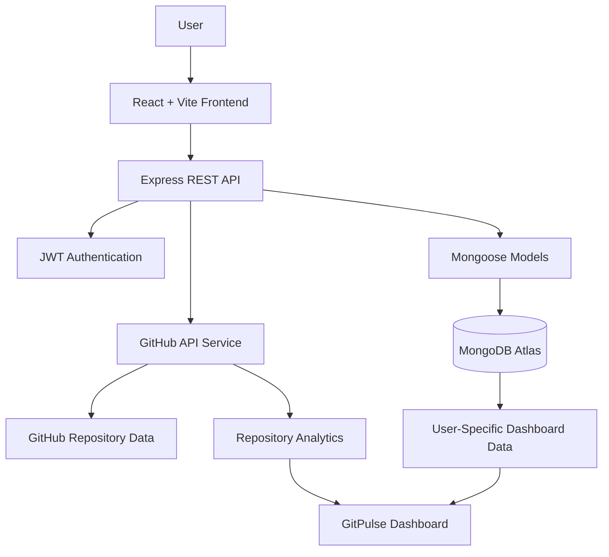
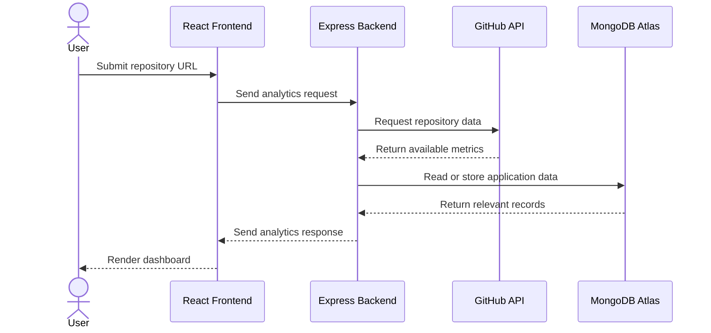

# ⚡ GitPulse — Your GitHub Repository, Decoded.

<p align="center">
  <strong>Turn repository activity into meaningful insights.</strong>
  <br />
  Understand your codebase, explore contribution patterns, and track repository health from one unified dashboard.
</p>

<p align="center">
  
  
  
</p>

<p align="center">
  <em>Less scrolling through repositories. More understanding what is happening inside them.</em>
</p>

---

## ✦ The Idea Behind GitPulse

A GitHub repository contains more than source code. It reflects development activity, collaboration, programming language choices, and the evolution of a project over time.

**GitPulse transforms repository information into a clear, visual analytics experience.**

Instead of manually exploring multiple GitHub pages, users can enter a public repository URL and explore the available insights through a single dashboard.

Whether you're reviewing your own project, exploring an open-source codebase, or learning how a repository evolves, GitPulse helps make repository information easier to understand.

## 🚀 What Can You Explore?

| Feature | What it does |
|---|---|
| 📊 Repository Dashboard | Brings available repository metrics together in one place. |
| 💓 Pulse Score | Presents a summarized repository activity indicator. |
| 💻 Language Insights | Visualizes the programming languages used in a repository. |
| 👥 Contributor Analytics | Displays available contributor information and contribution metrics. |
| 📈 Commit Activity | Helps explore available commit activity and recent development patterns. |
| 📥 Clone Activity | Shows GitHub-reported clone traffic when the required repository permissions are available. |
| 🌱 Repository Origin | Shows available origin or fork information from GitHub. |
| 🔐 Secure Authentication | Uses JWT-based authentication for protected application features. |
| 👤 Personal Dashboard | Associates saved repository data with the authenticated user. |

> **A note on clone analytics:** GitHub restricts repository traffic statistics to users with the required repository permissions. When clone statistics cannot be accessed, GitPulse reports the limitation instead of inventing numbers or presenting unavailable data as zero.

## 🎯 Why GitPulse?

GitHub already provides repository information, but exploring different sections can take time. GitPulse focuses on bringing useful information into a unified, visual experience.

- **One dashboard:** Explore multiple repository insights without jumping between pages.
- **Visual understanding:** Make language distribution and activity patterns easier to interpret.
- **Repository exploration:** Investigate public repositories using their GitHub URLs.
- **User-specific experience:** Keep authenticated application features associated with the correct user.
- **Honest analytics:** Distinguish real data, unavailable metrics, and missing activity.

## 🧰 Technology Stack

### Frontend
- React
- Vite
- JavaScript
- CSS

### Backend
- Node.js
- Express.js
- REST APIs
- JWT authentication

### Database
- MongoDB Atlas
- Mongoose

### External Integration
- GitHub REST API

### Development Tools
- Git and GitHub
- Visual Studio Code
- npm

## 🏗️ System Architecture



The frontend handles user interaction and visualization. The Express backend coordinates API requests, authentication, and database operations. GitHub provides repository information, while MongoDB stores application data.

## 🔄 How GitPulse Works

1. **Authenticate** — Sign in to access protected application features.
2. **Enter a repository** — Provide the URL of a GitHub repository.
3. **Fetch available data** — The backend requests repository information from GitHub.
4. **Process insights** — Available metrics are organized for dashboard presentation.
5. **Store application data** — Relevant user and repository records are managed through MongoDB and Mongoose.
6. **Explore the dashboard** — Review repository details, language insights, contributors, and available activity analytics.



## 📸 Screenshots

Add screenshots of your actual application here to showcase the interface.

| Repository Dashboard | Language Insights |
|---|---|
| Replace with your dashboard screenshot | Replace with your language analytics screenshot |

| Contributor Analytics | Clone Activity |
|---|---|
| Replace with your contributor screenshot | Replace with your clone analytics card |

**Tip:** Upload screenshots to a folder such as `docs/screenshots/` and use their repository-relative paths in the README.

For example:

```md

```

## ⚙️ Getting Started

Follow these steps to run GitPulse locally.

### Prerequisites

Install the following:

- Node.js and npm
- Git
- A MongoDB Atlas account or another supported MongoDB deployment
- A GitHub account and token configured for the features you intend to use

### 1. Clone the repository

```bash
git clone https://github.com/Priyanka170974/GitPulse.git
cd GitPulse
```

### 2. Install backend dependencies

```bash
cd backend
npm install
```

Create a `backend/.env` file using your project's environment configuration.

Example:

```env
PORT=5000
MONGO_URI=your_mongodb_connection_string
JWT_SECRET=replace_with_a_long_random_secret
JWT_EXPIRES_IN=7d
CLIENT_URL=http://localhost:5173
GITHUB_TOKEN=your_github_token
```

Use the exact variable names required by your current backend. Keep real credentials in `.env`, never in the README or `.env.example`.

Start the backend:

```bash
npm run dev
```

### 3. Install frontend dependencies

Open another terminal from the project root:

```bash
cd frontend
npm install
```

Configure the frontend API URL if your project requires an environment variable. Use the variable name expected by your existing frontend code.

Start the frontend:

```bash
npm run dev
```

Open the local URL printed by Vite, commonly `http://localhost:5173`.

## 🔐 Security & Data Integrity

GitPulse is designed to keep credentials and analytics handling separate from the public documentation.

- Store credentials in environment variables.
- Never commit real `.env` files, API tokens, or database passwords.
- Use `.env.example` only for placeholder values.
- Keep protected backend routes behind the authentication and authorization checks implemented by the application.
- Treat GitHub API rate limits and permission errors as expected conditions.
- Display clone statistics only when GitHub provides access to the relevant traffic endpoint.
- Do not interpret missing analytics as proof that a repository has no activity.

## 🧪 Testing

Run the tests available in your local project to verify API behavior, analytics handling, and frontend integration.

For this project, use the scripts actually defined in `backend/package.json` and any frontend test configuration. Example commands, if configured:

```bash
npm test
```

```bash
npm run build
```

Do not treat a command as supported until you confirm that its script exists in the relevant `package.json`.

## 🌍 Deployment

GitPulse can be deployed using a frontend hosting service and a backend hosting service, with MongoDB Atlas as the database.

A typical deployment setup:

- **Frontend:** Vercel
- **Backend:** Render
- **Database:** MongoDB Atlas

Before deploying:

1. Configure production environment variables in the hosting dashboards.
2. Set the frontend's API URL to the deployed backend.
3. Set the backend's allowed client origin to the deployed frontend URL.
4. Configure MongoDB Atlas network access for the backend environment.
5. Verify authentication, API connectivity, and repository analytics.
6. Confirm that secrets are not included in the deployed frontend bundle or committed source files.

## 🗺️ Roadmap

Ideas for future development:

- [ ] More detailed repository activity timelines
- [ ] Improved repository comparison
- [ ] Exportable analytics reports
- [ ] Historical snapshots for tracked repositories
- [ ] Enhanced contributor activity visualization
- [ ] More detailed API error and rate-limit feedback

These are potential improvements, not claims that the features are already implemented.

## 👩‍💻 About the Developer

**Priyanka Jain**  
Computer Science & Engineering — AI

GitPulse is a project focused on full-stack development, GitHub API integration, data visualization, authentication, and database-backed application design.

- **GitHub:** [@Priyanka170974](https://github.com/Priyanka170974)
- **Project Repository:** [Priyanka170974/GitPulse](https://github.com/Priyanka170974/GitPulse)

## 🤝 Contributions

Suggestions, bug reports, and improvements are welcome. If you'd like to contribute:

1. Fork the repository.
2. Create a feature branch.
3. Make your changes and test them.
4. Open a pull request describing the improvement.

## 📄 License

Add a `LICENSE` file and mention the selected license here before presenting the project as open source.

---

<p align="center">
  <strong>GitPulse ⚡</strong>
  <br />
  <em>See the activity. Understand the code. Follow the pulse.</em>
</p>
